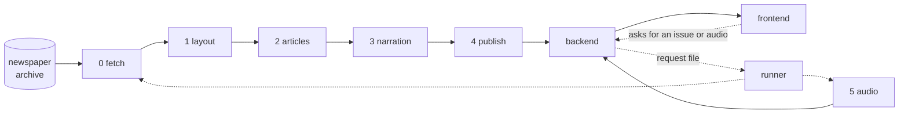

# Der Allgemeine Hörbote

Listen to a newspaper instead of reading it. Hörbote (`hoerbote` in
code) turns an issue into a spoken overview, page by page. While you
listen, the page is on screen with the current article highlighted.

The demo plays the *Berliner Tageblatt* from exactly 100 years ago,
which is in the public domain.

## How it works

A pipeline of five jobs prepares each issue. A sixth job turns it
into speech. Both cost money per issue, so both run only when someone
asks for them in the web app:

| | |
|---|---|
| [0_fetch](jobs/0_fetch/) | downloads an issue: the PDF, the text per page, the rights statement |
| [1_layout](jobs/1_layout/) | finds headlines, text columns, pictures and captions on each page (a vision model, on a GPU) |
| [2_articles](jobs/2_articles/) | groups the page text into articles |
| [3_narration](jobs/3_narration/) | summarizes the articles and writes a spoken overview per page (an LLM) |
| [4_publish](jobs/4_publish/) | prepares the JSON and page images the web app shows |
| [5_audio](jobs/5_audio/) | turns the narration into speech, a whole issue at a time (on request) |
| [backend](backend/) | serves the issues, their audio and the web app |
| [frontend](frontend/) | the web app |
| [runner](runner/) | runs the jobs for an issue, or the audio job, when it's asked for |
| [shared](shared/) | the file formats the jobs exchange |
| [config](config/) | the papers that can be fetched |

Each job writes into a numbered folder in the issue's directory,
`data/issues/<run_id>/` (`00_…` to `05_…`), and reads what the jobs
before it wrote. That's the only way the jobs talk to each other.
`status.json` next to them records which jobs succeeded. A job only
needs the run_id and can always be run again.

## Run it

You need Docker. Each component reads its settings from environment
variables. A `.env` file next to its code is read too, and the
`.env.example` there lists what it needs.

Serve whatever is already in `data/`:

    docker compose up -d backend

Then open http://localhost:8001.

Or with the runner as well, so issues and audio can be asked for in
the web app:

    docker compose --profile jobs build
    docker compose up -d

To update a server later, run `scripts/deploy.sh` there. It pulls,
rebuilds every image, waits for a running job to finish, restarts what
changed and removes the old images. The files git doesn't have
(`backend/.env`, the jobs' `.env`, `config/papers_local.toml`) have to be
on the server already.

To run an issue right away, or to continue a failed one, see the
[runner](runner/). Each job's README shows how to run that job on its
own.

## Develop

Each job, `backend/`, `runner/` and `shared/` is its own Python project
([uv](https://docs.astral.sh/uv/), Python 3.14) with its own
dependencies. Run commands from the repo root:

    uv run --project jobs/2_articles python jobs/2_articles/run.py <run_id>

`scripts/check.sh` runs the linters and all tests. To make it the
pre-commit hook:

    git config core.hooksPath scripts/hooks

Good to know:

- After changing `shared/`, refresh it in the project you run:
  `uv sync --project <project> --reinstall-package hoerbote-shared`.
- Every job and the backend find the data in `DATA_ROOT`, default
  `./data` (`/data` in the images).
- With `docker run`, pass `--user "$(id -u):$(id -g)"`, or the output in
  `data/` belongs to root.

## Costs

One issue costs roughly 12 ct for the layout job's GPU and 4 ct for the
narration. Its speech, only if someone asks for it, adds about 30 ct for
a 29-page issue (Gemini's 2026 introductory price; double that from
January 2027).

## Content and rights

`data/` holds the full text and images of every fetched issue, so it's
never committed. The fetch job records each issue's rights statement.
Only issues marked open (public domain or CC) may be shown publicly, so
only those are visible without logging in. The only newspaper content
in the repo is a public-domain test fixture.

## Licence

The code is under the [MIT licence](LICENSE). It doesn't cover:

- the newspaper content: each issue comes with its own rights
  statement, which the web app shows as its credit line.
- the layout model's weights, [Surya](https://github.com/datalab-to/surya)
  by Datalab, which the layout job downloads. They're under Datalab's
  [modified OpenRAIL-M licence](https://huggingface.co/datalab-to/surya-ocr-2/blob/main/LICENSE):
  free for personal and research use and for small companies, with use
  restrictions and attribution required. It covers the model's output
  too, so also the `*.layout.json` files in the test fixture.
- the dependencies, each under its own licence. One of them, PyMuPDF
  (used by the layout, articles and publish jobs), is AGPL-3.0.

## Known issues

- Two articles merge when nothing on the page separates them (no
  headline, no line).
- Listings (TV programme, obituaries) are treated as articles and mostly
  dropped by the narration.
- Headlines of old, OCR'd issues are reconstructed by the LLM and are
  sometimes wrong.
- Jumping into an article can start with a transition from the previous
  one ("Meanwhile, …").
