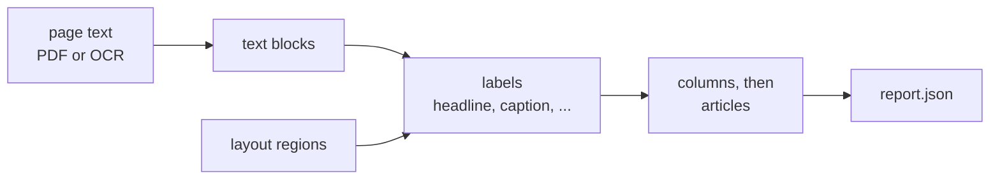

# Articles job

Groups each page's text into articles, using the regions the layout job
found. No model, no network. It takes seconds per issue.

Writes `02_articles/`:

- `report.json`: per page, its articles (headline guess, text, position)
- `debug.json`: what the debug view shows

To check the grouping by eye, build the debug view: every page with its
articles drawn on top, as `02_articles_view.html` in the run's folder.

    uv run --project jobs/2_articles python jobs/2_articles/debug_view.py <run_id>

## Run it

Needs the layout job's output. With uv, from the repo root:

    uv run --project jobs/2_articles python jobs/2_articles/run.py <run_id>

Or with Docker:

    docker build -f jobs/2_articles/Dockerfile -t hoerbote-articles .
    docker run --rm --user "$(id -u):$(id -g)" -v "$(pwd)/data:/data" hoerbote-articles <run_id>

No configuration is needed.

## How it works

1. **Read the text** as blocks with position and font. `pdf_io.py`
   reads a PDF's own text (e-papers). `alto_io.py` reads the OCR files
   of a scanned issue. Which one applies is set in `00_source.json`.
2. **Label the blocks** (`labels.py`, `layout_boundaries.py`): headline
   or body text by font size, refined by the region each block falls
   into. Text inside pictures or tables is left out.
3. **Group into articles** (`articles.py`): find the columns
   (`columns.py`), split them at headlines and printed lines, and join
   the pieces across columns (`segments.py`). Captions go to their
   picture's article.

The order comes from columns and position on the page. The layout
model's own reading order isn't used, because it sometimes jumps into
the wrong article.

## Good to know

- Thresholds are in PDF points, tuned on a 992 pt wide page, and scaled
  to the page at hand (`bbox.scaled`).
- A new text source means a new reader that returns the same text
  blocks.
- Known gaps: two articles merge when nothing separates them (no
  headline, no line), and a box of several short items becomes one
  article.

## Tests

    uv run --project jobs/2_articles --group dev pytest jobs/2_articles/tests/

They run against hand-checked article texts of a public-domain issue
(`tests/fixtures/`).
